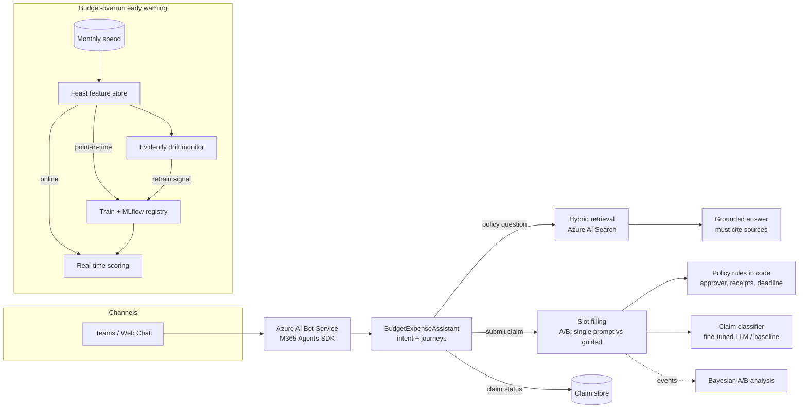

# Budget & Expense Assistant

Conversational AI and machine learning for public-finance operations: a policy assistant grounded in budget circulars, guided expense-claim journeys, claim classification with LLM fine-tuning, and a budget-overrun early-warning model with a full MLOps loop.

> Portfolio project on **synthetic data**. Every policy, department and claim is fictional.

## What it demonstrates

| Capability | Where |
|---|---|
| **RAG** over policy documents: structure-aware chunking, hybrid retrieval (BM25 + vectors, Reciprocal Rank Fusion), answers that must cite sources | `rag/`, `assistant.py` |
| **Vector database**: Azure AI Search index with an HNSW vector field and hybrid queries | `rag/index_azure.py`, `rag/retrieval.py` |
| **Conversational platform**: multi-journey assistant (policy Q&A, claim submission, claim status) on **Azure AI Bot Service** via the **Microsoft 365 Agents SDK** | `assistant.py`, `bot/app.py` |
| **Fine-tuning**: chat-format training data, Azure OpenAI fine-tuning job, benchmark against few-shot prompting and a classical baseline | `finetune/`, `classify.py` |
| **Feature store**: Feast with point-in-time training joins and online serving | `feature_repo/`, `features/build.py`, `model/serve.py` |
| **Traditional ML**: gradient-boosted budget-overrun classifier with a time-based split | `model/train.py` |
| **MLOps**: MLflow tracking and model registry, CI release gates, drift-monitoring workflow | `model/`, `evals/`, `.github/workflows/` |
| **Drift monitoring**: Evidently drift report and retraining signal | `monitoring/drift.py` |
| **Bayesian A/B testing** of conversational flows: probability-to-beat-control and expected loss | `experiments/bayesian_ab.py` |
| **Governance**: deterministic policy rules in code, a grounding guardrail, Entra ID auth with no keys, structured outputs | throughout |

## Architecture



## Results (synthetic data, offline)

These numbers come from running `scripts/run_pipeline.sh`. Synthetic data is cleaner than real finance data, so read them as proof that the pipeline works, not as production performance.

**Retrieval** (22 paraphrased policy questions; offline hashing embedder standing in for an embedding model)

| Chunking / mode | hit@1 | hit@3 | MRR |
|---|---|---|---|
| fixed-size / keyword | 0.73 | 0.86 | 0.79 |
| fixed-size / hybrid | 0.82 | 0.91 | 0.86 |
| by-heading / keyword | 0.82 | 0.86 | 0.84 |
| by-heading / vector | 0.82 | 0.95 | 0.89 |
| **by-heading / hybrid** | **0.86** | 0.91 | **0.89** |

Structure-aware chunks, prefixed with the document and section title, beat fixed windows in every mode. Hybrid fusion ranks the right section first most often. Run `python -m budget_assistant.rag.eval_retrieval --azure` to repeat this with real embeddings.

**Claim classification** (200 held-out claims, about half worded in ways never seen in training; 4% label noise in training)

| Classifier | Accuracy | Macro-F1 |
|---|---|---|
| TF-IDF + logistic regression (baseline) | 0.84 | 0.84 |
| Few-shot LLM | run `finetune.benchmark --live` | |
| Fine-tuned LLM | run `finetune.submit`, deploy, then `--live` | |

The baseline sets the bar. The benchmark records accuracy, latency and cost per 1,000 claims, so the "is fine-tuning worth it?" decision rests on all three.

**Budget-overrun model** (train FY2023, validate FY2024): ROC AUC 0.98, precision 0.95, recall 0.85.

**Drift** (FY2025 against the training window): 4 of 6 features drifted (burn rate, variance to budget, open commitments, prior-year overrun), so **retraining is recommended**. The FY2025 data carries an intended shift: new capital programmes committed up front.

**Bayesian A/B** (2,000 simulated users, true completion 62% vs 68%): P(guided > single prompt) = 0.9996, expected loss of shipping guided ≈ 0, 95% interval for the lift [+2.9, +11.2] points, so the decision is **ship guided**.

## Design decisions

- **Rules stay in code.** Approval levels, receipt requirements and the 30-day deadline come from the policy circulars and are enforced deterministically. The model extracts and explains; it never decides money matters.
- **No citation, no answer.** If the model's answer doesn't cite a retrieved source, the assistant declines instead of guessing. The live eval includes out-of-scope questions that must be refused.
- **Training and serving share features.** Feast definitions feed both the point-in-time training join and online scoring, and the label is kept apart from the features so nothing leaks from the future.
- **The fine-tuning test set is honest.** It includes wording never seen in training, because that's where an LLM should earn its cost over a cheap classifier.
- **Assignment is sticky.** Users are hashed into a flow, so each person always gets the same variant.

## Quick start

```bash
uv venv && source .venv/bin/activate
uv pip install -e ".[dev]"

pytest -q                       # 25 tests, no Azure needed
./scripts/run_pipeline.sh       # data -> Feast -> MLflow -> scoring -> drift -> evals
mlflow ui --backend-store-uri sqlite:///mlflow.db   # browse runs and the model registry
```

### With Azure

```bash
cp .env.example .env && az login
python -m budget_assistant.rag.index_azure                       # build the Azure AI Search vector index
python -m budget_assistant.finetune.submit --base-model <model> --wait
python -m budget_assistant.finetune.benchmark --live             # baseline vs few-shot vs fine-tuned
python evals/run_evals.py --live                                 # grounded-answer and refusal gate
python -m budget_assistant.bot.app                               # bot endpoint on :3978/api/messages
```

Point an Azure Bot resource at `/api/messages`, enable the Teams and Web Chat channels, and test locally with the Microsoft 365 Agents Playground. Delete fine-tuned deployments after benchmarking, because they are billed per hour while deployed.

## CI/CD

- `ci.yml`: lint, type check, tests and the offline release gate on every push, then the full ML pipeline with the drift report and results uploaded as artifacts.
- `drift-monitor.yml`: drift check that fails when retraining is needed. It runs on demand here because the synthetic data drifts on purpose; schedule it weekly against real data.

## Layout

```
src/budget_assistant/
  assistant.py         journeys, grounding guardrail, policy rules, A/B logging
  bot/app.py           Azure AI Bot Service adapter (M365 Agents SDK)
  rag/                 chunking, hybrid retrieval, Azure AI Search index, retrieval eval
  classify.py          baseline / few-shot / fine-tuned classifiers
  finetune/            data prep, job submission, benchmark
  features/build.py    feature engineering + Feast registration
  model/               training (MLflow) and online scoring (Feast)
  monitoring/drift.py  Evidently drift report
  experiments/         Bayesian A/B analysis
feature_repo/          Feast definitions
evals/                 golden sets and release gate
```

Author: Indranil Majumder
